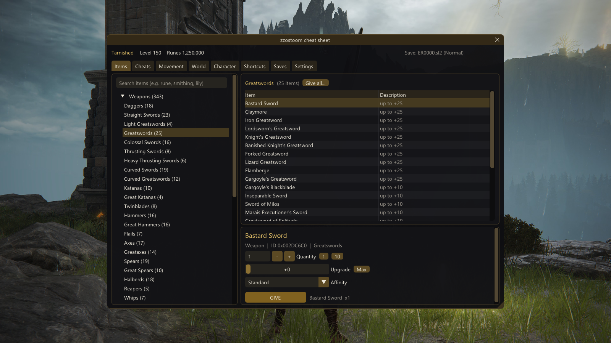
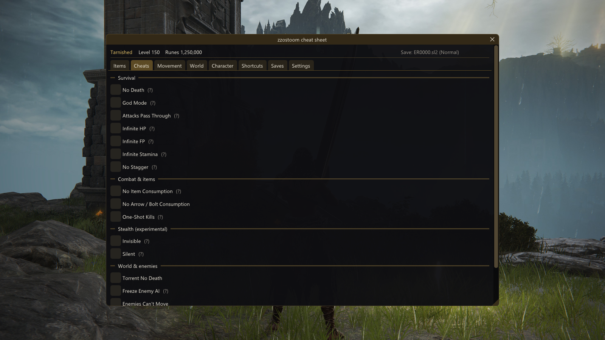
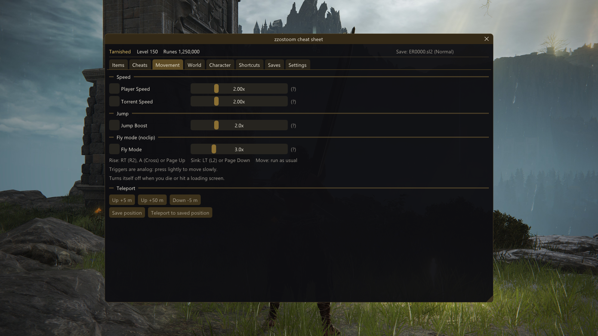
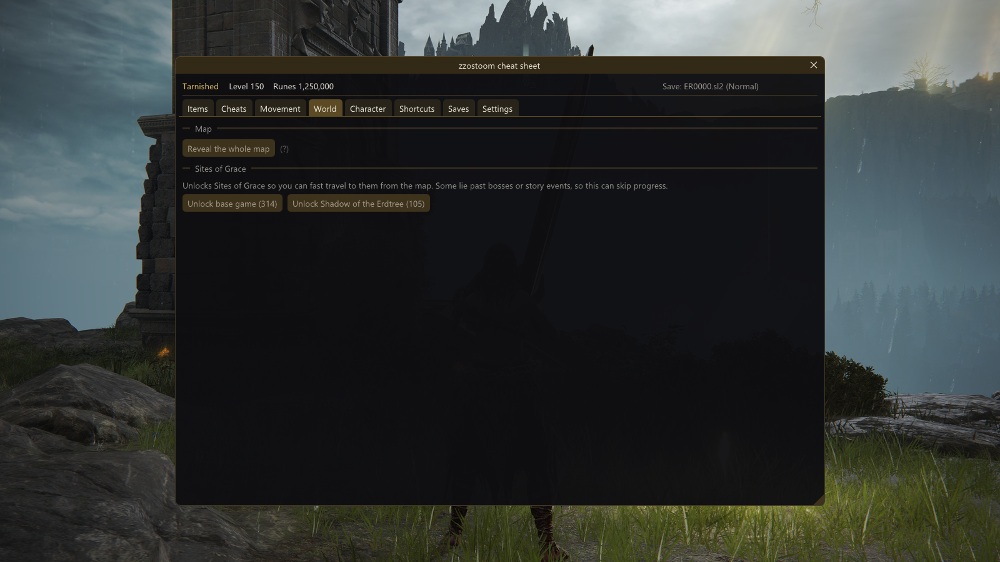
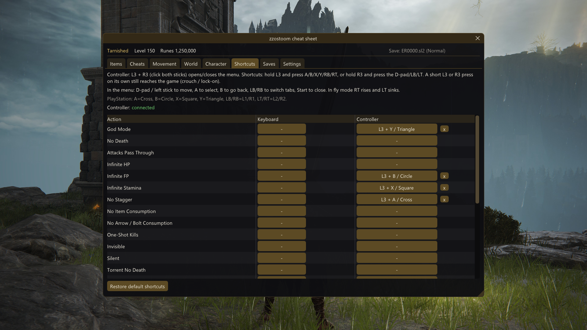
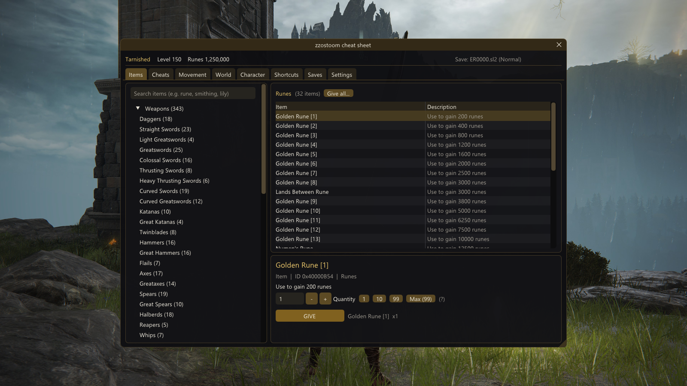
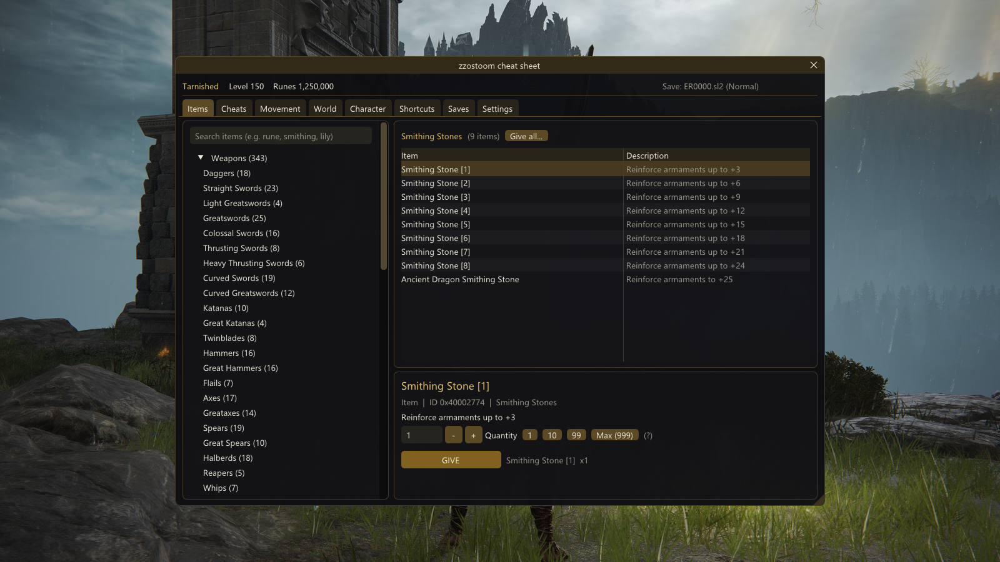

# zzostoom cheat sheet

**In-game cheat menu for Elden Ring, no Cheat Engine needed.**

Loaded by [Mod Engine 3](https://github.com/garyttierney/me3) as a DLL. Give yourself any item, toggle cheats instantly, run faster, fly with noclip, reveal the map and unlock every Site of Grace, all from inside the game, with keyboard/mouse **or controller**. Works with normal saves and **Seamless Coop** (`.co2`).

**[Download the latest release](https://github.com/EneSuckSoi/zzostoom-cheat-sheet/releases/latest)**



## Features

- **Items**: every item in the game, DLC included (2,700+), grouped like the in-game inventory (weapon types, armor, Runes, Smithing Stones, Flora, Spells, Spirit Ashes, Ashes of War, Key Items...). Pick quantity, upgrade level, affinity and spirit ash level. Search box and "Give all".
- **Cheats** (applied the moment you tick them): God Mode, No Death, Attacks Pass Through, Infinite HP / FP / Stamina, No Stagger, no item / arrow consumption, One-Shot Kills, Torrent No Death, Freeze Enemy AI, Enemies Can't Move, and experimental Invisible / Silent.
- **Movement**: player speed, Torrent speed, jump boost (all working with Seamless Coop), fly mode with noclip, teleport up/down, save a position and teleport back.
- **World**: reveal the whole map, unlock all Sites of Grace (base game and Shadow of the Erdtree separately).
- **Character**: add runes, edit attributes, Scadutree and Revered Spirit Ash blessings.
- **Shortcuts**: bind any cheat to a key and/or a controller combo (hold L3 or R3 + a button). Saved between sessions.
- **Saves**: list of your save files and characters, automatic backup before the first item of a session.

| | |
|---|---|
|  |  |
|  |  |
|  |  |

## Requirements

- Elden Ring **1.17.1** (Steam, `eldenring.exe` 2.7.1.0)
- [Mod Engine 3](https://github.com/garyttierney/me3)
- Windows 10/11, DirectX 12
- Optional: Seamless Coop

## Installation

1. Close the game and download `zzostoom-cheat-sheet-1.3.0.zip` from [Releases](https://github.com/EneSuckSoi/zzostoom-cheat-sheet/releases/latest).
2. Copy `zzostoom_cheat_sheet.dll` into your ME3 profile's mod folder, usually  
   `%LOCALAPPDATA%\garyttierney\me3\config\profiles\eldenring-mods\`
3. Open the `.me3` profile you launch the game with (e.g. `eldenring-default.me3`) and add:
   ```toml
   [[natives]]
   path = "eldenring-mods/zzostoom_cheat_sheet.dll"
   ```
   The path is relative to the `.me3` file. Using Seamless Coop? Keep its `ersc.dll` entry and just add this one.
4. Start the game through ME3. "zzostoom cheat sheet ready" appears in the top-left corner.

To uninstall, remove those two lines and delete the DLL.

## Controls

| | Keyboard | Controller |
|---|---|---|
| Open / close menu | `INSERT` (changeable, e.g. the key under Esc) | `L3 + R3` |
| Navigate | mouse | D-pad / left stick, A select, B back, LB/RB tabs, Start close |
| Fly mode up / down | Page Up / Page Down | RT or A / LT |

Default controller shortcuts: `L3+Y` God Mode, `L3+B` Infinite FP, `L3+X` Infinite Stamina, `L3+A` No Stagger, `R3+Up` Player Speed, `R3+Right` Torrent Speed, `R3+Down` Fly Mode, `R3+Left` Save Position, `R3+LB` Teleport to saved position.
PlayStation controllers work through Steam Input.

Settings and shortcuts are saved in `zzostoom_cheat_sheet.ini` next to the DLL. If something doesn't work, open an issue and attach `zzostoom_cheat_sheet.log`.

## Important

- **Offline / Seamless Coop only.** Do not use it on the official online servers.
- Back up your saves. The mod backs up the active save automatically, but use it at your own risk.
- Unlocking all Sites of Grace can skip parts of the game.

## License and credits

Free to use. You may share, modify or build on it **only if you credit "zzostoom" and link to this repository** (https://github.com/EneSuckSoi/zzostoom-cheat-sheet). Selling it is not allowed. See [LICENSE](LICENSE).

Made by **zzostoom**. Uses [Dear ImGui](https://github.com/ocornut/imgui) (MIT) and [MinHook](https://github.com/TsudaKageyu/minhook) (BSD 2-Clause), see [THIRD_PARTY_NOTICES.txt](THIRD_PARTY_NOTICES.txt).
